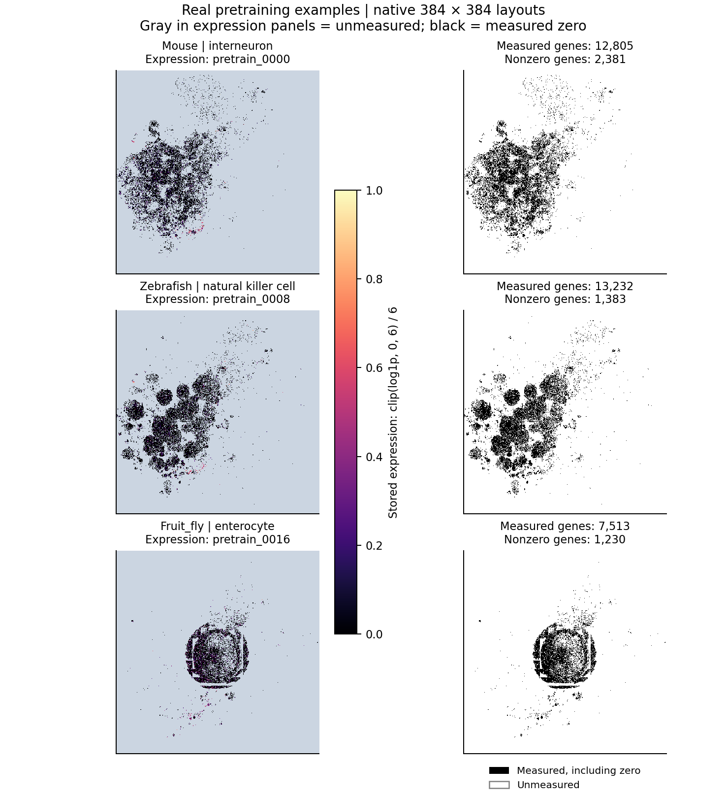
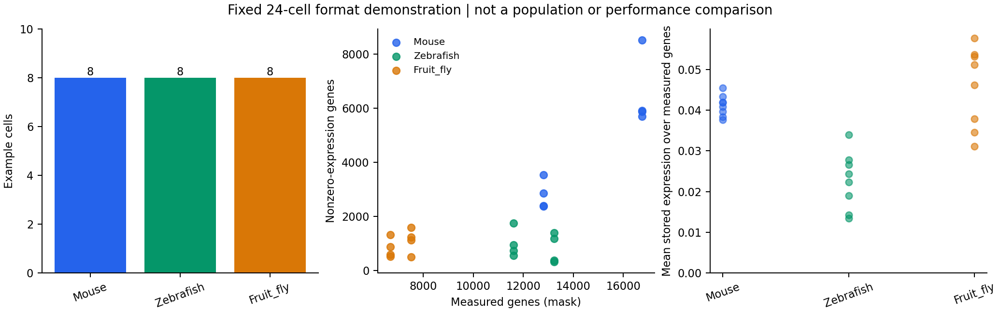

# Image Atlas: download and use

Download the full collection from **[Image Atlas](https://pan.baidu.com/s/1FuoHnEJN9FRvOBio5uutYQ?pwd=xabe)**. Place the downloaded contents in `CellNet/datasets/pretraining/full/`, with `metadata.json` directly inside `full/`. Download the release's complete file set and keep its relative paths. The share extraction code is `xabe`. The `.tar.gz` files in `class_shards/` remain compressed: the reader streams their cell records directly.

The repository includes a separate 24-cell example for trying the pipeline. The full Image Atlas remains a separately downloaded dataset; its large data files are ignored by Git.

## Source ownership in this release

Keep `cell_sources.json.gz` with the downloaded atlas. This compact index identifies the original source dataset for each of the 44,489,429 merged CellxGene cells, so the reader selects the correct measurement mask automatically. It covers 189 source datasets and was reconstructed from the frozen dataset order, exact original cell-QC rules and deterministic remapping order. Every recovered storage-bucket count matches the materialized shards.

The reader verifies the index's published SHA256, validates dataset UUIDs and mask rows, and checks that each selected cell is covered. Existing images, fitted gene positions and model weights are reused. A missing or inconsistent index produces an explicit error. Downstream conversion of your own H5AD uses its measured gene panel and the release's fixed assets independently.

## Directory layout

```text
CellNet/                         <-- --release points here
├── assets/
│   ├── gene_vocab.json          # Fixed gene order / identity indices
│   ├── species_layouts.npz      # Fitted native gene-to-pixel layouts
│   ├── layout_projection.json  # Optional new-gene projection settings
│   ├── layout_projection.npz   # Optional fitted projection arrays
│   ├── layout_neighbors.ann    # Optional fitted nearest-neighbor index
│   └── identity_projection.npz # Optional fitted identity projection
├── weights/
│   ├── config.json
│   ├── cellnet.pt
│   └── projector.pt
└── datasets/pretraining/
    ├── example/                # Included 24-cell portable NPZ example
    ├── full/                   # Download the Image Atlas contents here
    │   ├── metadata.json
    │   ├── release_manifest.json
    │   ├── shards_manifest.json.gz
    │   ├── cell_sources.json.gz # Per-cell source ownership for merged data
    │   ├── gene_vocab.json
    │   ├── cell_type_vocab.json
    │   ├── class_shards/
    │   │   └── class_*/
    │   │       └── *.tar.gz
    │   ├── masks/
    │   │   ├── dataset_index.json
    │   │   └── gene_masks.npy
    │   └── pixel_maps/
    │       ├── dataset_index.json
    │       └── gene_to_flat_pixel.npy
    ├── figures/
    └── FORMAT.md
```

The download also supplies its file inventory, available integrity digests, data card and source information at the atlas root. Keep these files with the data. A common placement error is `full/Image_atlas/metadata.json`; move the contents of that extra wrapper directory up so the path is `full/metadata.json`.

## Download the model assets and check the atlas

Install the repository following [README.md](../../README.md), including `git lfs pull`. Set the absolute clone path once; the commands below work from any current directory, including paths containing spaces:

```bash
export CELLNET_RELEASE="/absolute/path/to/CellNet"
git -C "$CELLNET_RELEASE" lfs pull

python "$CELLNET_RELEASE/examples/verify_image_atlas.py" \
  --release "$CELLNET_RELEASE" \
  --data "$CELLNET_RELEASE/datasets/pretraining/full"
```

The default check reads `release_manifest.json` and its referenced compressed shard inventory, then checks every selected file's presence and size, the vocabulary and native layouts against the release assets, and a small number of real cell records. A full check inspects the filesystem entry for every shard; partial-download selections check only the selected shards plus shared assets. Add `--checksums` to read and hash every catalogued data file after the download. The report separates comparisons against published SHA256 or independently verified MD5 values from hashes computed without a trusted reference. Hashing the full collection reads the entire dataset:

```bash
python "$CELLNET_RELEASE/examples/verify_image_atlas.py" \
  --release "$CELLNET_RELEASE" \
  --data "$CELLNET_RELEASE/datasets/pretraining/full" --checksums \
  --output "$CELLNET_RELEASE/atlas_verification.json"
```

Use the same release directory for verification, batch preparation and model loading. The atlas vocabulary fixes the indices into the model's gene-identity table. Its native pixel maps must match `assets/species_layouts.npz`. The reader checks that identity and rebuilds each cell's measurement mask from its source dataset, retaining the fitted pixel positions.

## Partial downloads

Always download all shared root files, including both vocabularies, `cell_sources.json.gz`, `release_manifest.json` and `shards_manifest.json.gz`, plus the complete `masks/` and `pixel_maps/` directories. For a smaller shard selection, keep the original `class_shards/` paths and select the files explicitly in verification and batch preparation:

```bash
python "$CELLNET_RELEASE/examples/verify_image_atlas.py" \
  --release "$CELLNET_RELEASE" --storage-classes class_536

python "$CELLNET_RELEASE/examples/prepare_pretraining_batch.py" \
  --release "$CELLNET_RELEASE" --storage-classes class_536 \
  --output "$CELLNET_RELEASE/selected_views.pt" --cells 2 --views 2
```

Replace `class_536` with a class in your downloaded release. Use `--shards class_shards/class_536/shard-00000.tar.gz` for individual files, replacing the example with an exact path from the shard inventory referenced by `release_manifest.json`. Select either classes or shards. The verification report records when only a selected download was checked.

## Prepare a pretraining batch

```bash
python "$CELLNET_RELEASE/examples/prepare_pretraining_batch.py" \
  --release "$CELLNET_RELEASE" \
  --data "$CELLNET_RELEASE/datasets/pretraining/full" \
  --output "$CELLNET_RELEASE/prepared_views.pt" \
  --cells 2 --views 2 --keep-fraction 0.75 --seed 20261015

python "$CELLNET_RELEASE/examples/pretrain.py" \
  --release "$CELLNET_RELEASE" --init cellnet \
  --batch "$CELLNET_RELEASE/prepared_views.pt" \
  --n-global 2 --steps 1 --device cpu \
  --output "$CELLNET_RELEASE/continued_weights"
```

Omitting `--data` selects an available `datasets/pretraining/full/` under `--release`, otherwise the bundled `example/`. To explicitly try the 24-cell example, use `--data "$CELLNET_RELEASE/datasets/pretraining/example"`. Select new output paths for subsequent runs.

Stored atlas expression is already normalized to [0,1] and stored as float16. The reader returns float32 images with expression and measurement-mask channels, together with integer gene IDs. Measured zero expression retains mask=1 and a positive gene ID. Unmeasured pixels have expression=0, mask=0 and ID=0. Each prepared view independently masks measured genes while keeping expression, masks and IDs aligned for the same cell.

The command above demonstrates one model update on a prepared batch. For training, stream independent batches and select an appropriate GPU and schedule; see [PRETRAINING.md](../../docs/PRETRAINING.md).

## Read cells directly

The same reader supports native Image Atlas shards and the portable NPZ example:

```python
import os
from pathlib import Path
from itertools import islice
from cellnet.pretraining_data import iter_pretraining_cells

release = Path(os.environ['CELLNET_RELEASE'])
cells = iter_pretraining_cells(
    release / 'datasets/pretraining/full', release=release,
)
for sample in islice(cells, 2):
    print(sample['metadata']['sample_id'], sample['metadata']['species'])
    print(sample['image'].shape, sample['gene_ids'].shape)
    # image: float32 [2, 384, 384]; gene_ids: int64 [384, 384]
```

## DNA identities and fitted mapping

These assets have different roles:

| Asset | Role | Loaded from |
| --- | --- | --- |
| DNA-derived gene identities | Frozen 256-dimensional identity vectors used by the model | `weights/cellnet.pt` |
| Gene vocabulary | Stable ordering that connects gene names to identity rows | `assets/gene_vocab.json`, matched against the atlas copy |
| Fitted gene-to-pixel layout | Exact image position of each native gene | `assets/species_layouts.npz`, matched against atlas `pixel_maps/` |
| Measurement masks | Which genes were measured in each source dataset | Atlas `masks/` |

Normal pretraining and downstream use load the stored DNA-derived identities and fitted positions automatically. They do not fit a new mapping, recompute DNA embeddings, or require a separate DNA-model download. Raw 1,920-dimensional DNA feature vectors are different from the frozen 256-dimensional model identity table; compatible raw vectors are needed only when explicitly registering new genes through the optional projection workflow.

## Use your own H5AD for downstream applications

Keep the model and `assets/` from `git lfs pull`. The converter reads the fitted native mapping from `--release`, aligns stable gene IDs to its vocabulary, and converts the measured expression panel automatically. The full Image Atlas is needed only when your workflow reads the pretraining collection.

```bash
python "$CELLNET_RELEASE/examples/embed_h5ad.py" \
  --release "$CELLNET_RELEASE" \
  --input "/path/to/cells.h5ad" --output "/path/to/embeddings.npy" \
  --species Human --input-scale counts --batch-size 8 --device cpu
```

Set `--species` to the exact fitted namespace, such as `Human`, `Mouse`, `Zebrafish` or `Fruit_fly`. Use `--input-scale counts` for nonnegative counts; use `log1p` for expression already normalized to the model's 10,000-library-size, log1p scale. The default gene IDs come from `var_names`; `--gene-column` selects a stable-ID column, and `--layer-key` selects the expression layer. See [task examples](../../docs/TASK_EXAMPLES.md) for annotation, reference mapping, completion and other applications.

For the released vocabulary, the native layout and frozen identities are loaded directly. The larger `layout_neighbors.ann` and related projection assets support registering compatible embeddings for new genes through `CellNetImageConverter.from_embeddings`; that is a separate optional workflow described in the [main README](../../README.md#apply-the-fitted-converter-to-new-genes-or-species).

## Bundled example and figures

`example/` contains eight cells each from Mouse, Zebrafish and Fruit_fly, extracted from an existing 100,000-cell training sample. It retains original float16 expression, six dataset-specific measured-gene layouts and source annotations. [FORMAT.md](FORMAT.md) documents both data formats; `dataset_card.json` and `example/cells.csv` describe the example's scope and provenance.

```bash
python -m pip install -e "$CELLNET_RELEASE[visualization]"
python "$CELLNET_RELEASE/examples/visualize_pretraining_data.py" \
  --output "/path/to/pretraining_figures"
```





The figures show transcriptome expression in native pixel layouts. Gray pixels are unmeasured; black measured pixels have zero expression. Counts of measured or detected genes refer to the represented layout.

Upstream datasets retain their original terms and attribution. Consult the atlas's source information and the bundled example's dataset card when reusing data; the software license applies to CellNet code.
